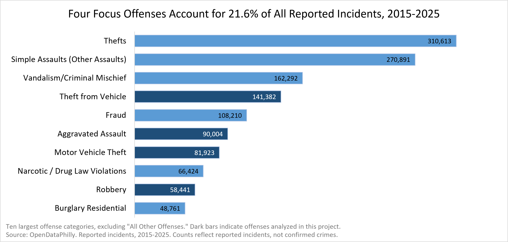
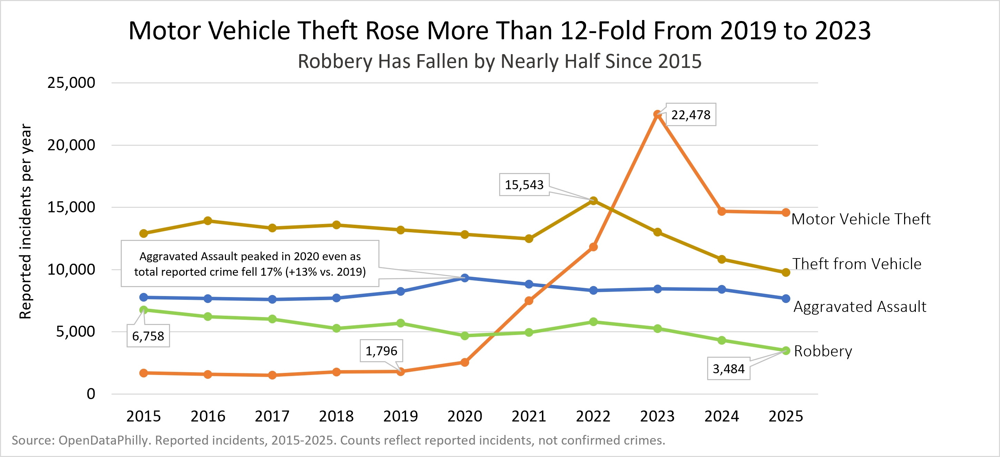
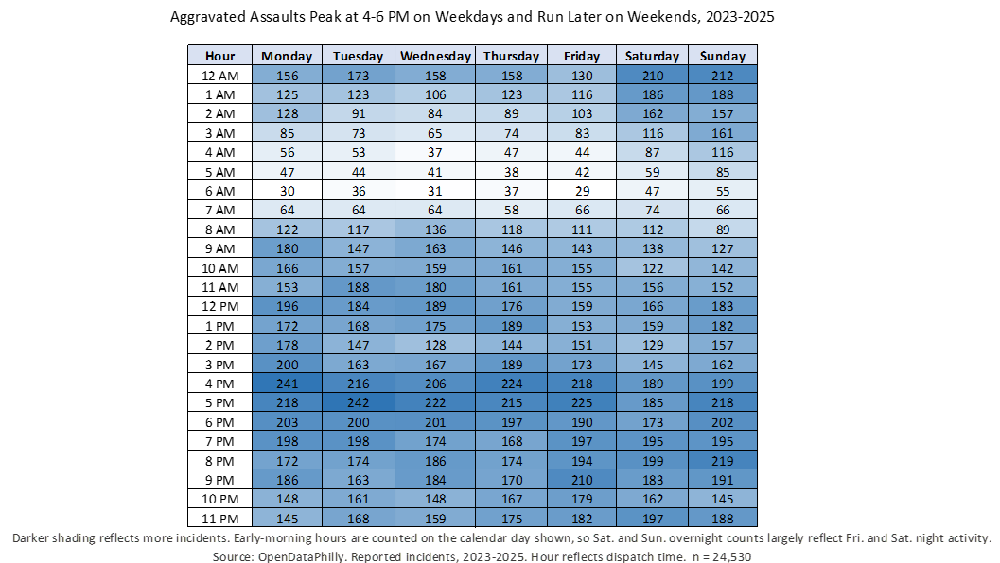
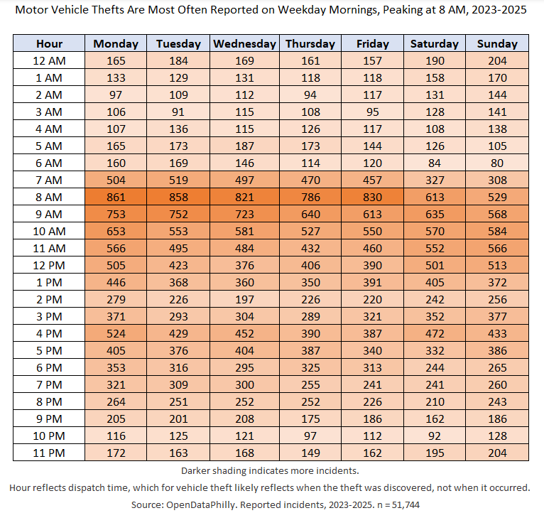
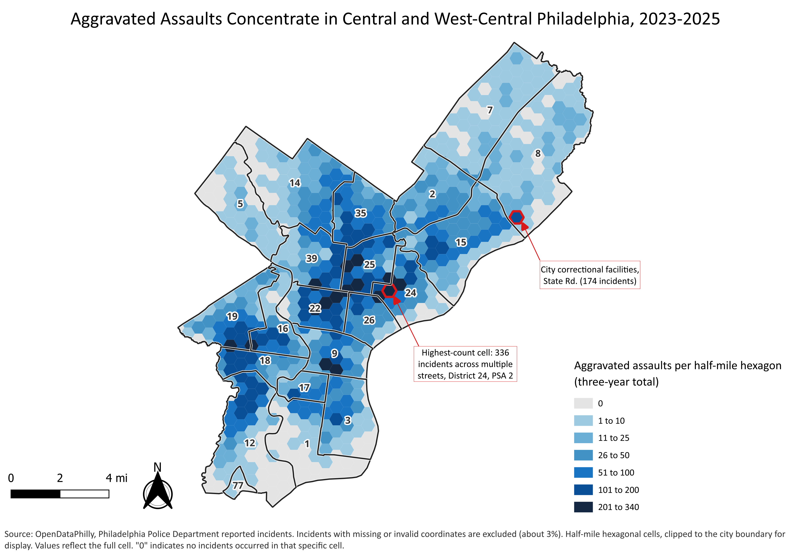
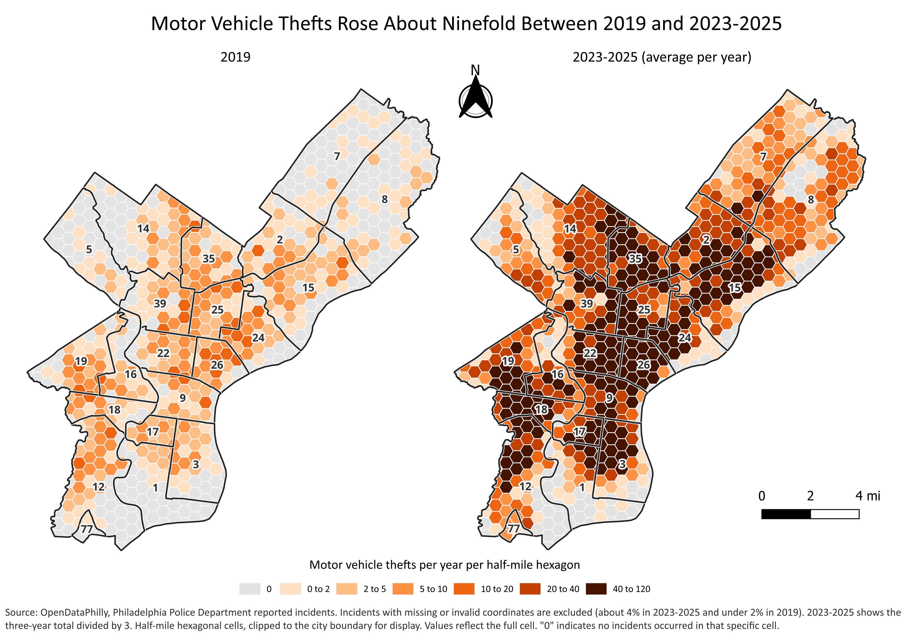
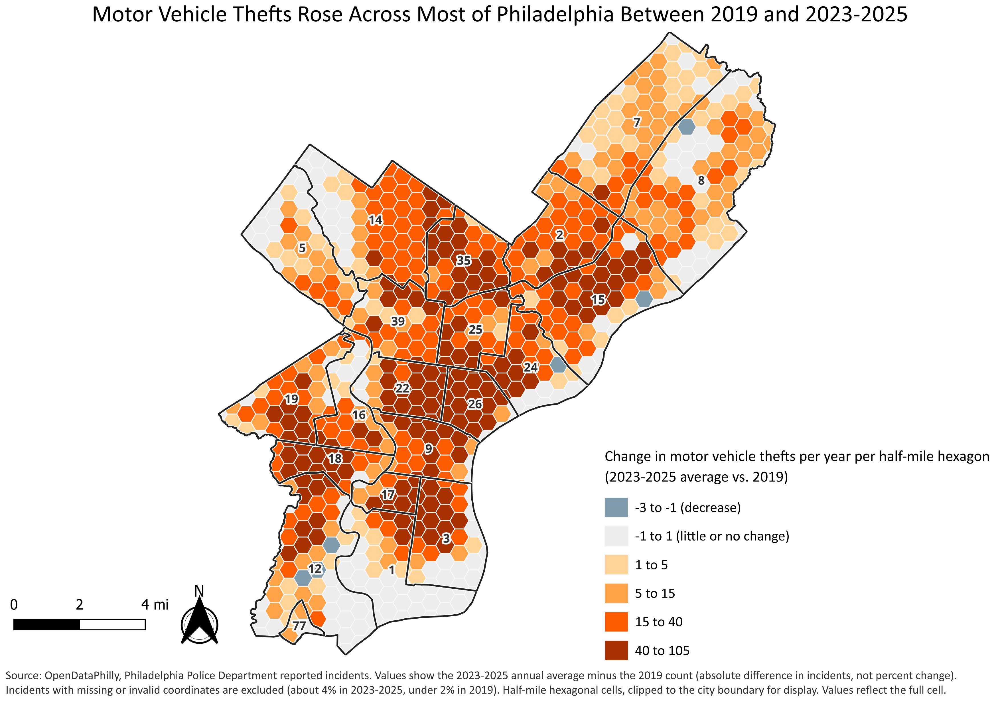

# Philadelphia Crime Analysis, 2015–2025

An analysis of reported crime incidents in Philadelphia, built from public OpenDataPhilly data. It follows four offenses (aggravated assault, motor vehicle theft, robbery and theft from vehicle) and maps hotspots for the first two. Tools: Excel and Power Query for cleaning and trends, QGIS for spatial analysis and maps.

**Author:** Ryan Nodine (GitHub: [Ryannodine](https://github.com/Ryannodine))

**Start here:** the one-page [crime analysis bulletin (PDF)](bulletin/Philadelphia_Crime_Analysis_Bulletin.pdf). This is a sample product built from public data. It is not an official police bulletin.

## Key findings

- **Motor vehicle theft** rose from 1,796 reports in 2019 to 22,478 in 2023, then fell to about 14,600 in 2025, still roughly 8 times the 2019 level.
- **Aggravated assault** stayed between about 7,600 and 8,500 a year, apart from 2020 (9,332), when citywide reported crime fell 17%.
- **Robbery** fell 48% from 2015 to 2025 (6,758 to 3,484).
- **Theft from vehicle** peaked at 15,543 in 2022 after a gradual rise from May to October, and was 9,770 in 2025.
- **When:** aggravated assault peaks 4–6 PM on weekdays and runs later on weekends. Motor vehicle theft reports peak around 8 AM on weekdays, which likely reflects when owners discover the loss.
- **Where:** aggravated assault clusters in a band across police districts 22, 24, 25 and 9, with secondary clusters in 16, 18 and 19. Motor vehicle theft rose across most of the city.

## Visuals

| | |
|---|---|
|  |  |
|  |  |

## Repository contents

| Folder | What is in it |
|---|---|
| `bulletin/` | One-page bulletin (Word and PDF) |
| `charts/` | Offense totals, trend line chart and hour-by-day heatmaps (PNG) |
| `maps/` | Hotspot and change maps (PNG) |
| `data/processed/` | Cleaned incident records with coordinates for aggravated assault (2023–2025) and motor vehicle theft (2019 and 2023–2025), plus `philly_crime_summary_tables.xlsx` (offense totals, yearly trends, hour-by-day tables) |
| `gis/` | Final GeoPackage layers: half-mile hexagon counts (full and clipped), city boundary, police districts and highlighted cells |
| `docs/` | `power_query_steps.txt`, the Power Query code used for cleaning |

## Methods

**Data source:** the Crime Incidents dataset published by the Philadelphia Police Department on [OpenDataPhilly](https://opendataphilly.org/datasets/crime-incidents/). Yearly files for 2015–2025 were combined in Power Query.

**Cleaning (Excel / Power Query).** The full code is in [`docs/power_query_steps.txt`](docs/power_query_steps.txt).
- Appended the yearly CSV files into one table and kept records dated 2015 or later.
- Built an `offense_group` field: UCR general code 400 becomes Aggravated Assault, 300 becomes Robbery, and everything else keeps its `text_general_code` label.
- Built `hour_final` from the dispatch hour, using `dispatch_time` when the hour was blank (2023).
- Built `lat_final` and `lng_final` from `lat` and `lng`, using `point_y` and `point_x` where those were empty (2020 onward).
- Set `has_coords_final = 1` only for points inside the Philadelphia bounding box, which removes missing coordinates and records stored in another coordinate format.
- Added `dist_current`, which recodes District 6 to District 9 after the May 1, 2024 merger.

**Trends and time patterns (Excel).** Pivot tables and charts for offense totals, yearly counts and hour-by-day heatmaps. The values are saved in `data/processed/philly_crime_summary_tables.xlsx`.

**Spatial analysis (QGIS).**
- Loaded the incident coordinates (EPSG:4326) and reprojected them to EPSG:2272 (NAD83 / Pennsylvania South, US feet).
- Created a hexagon grid with a half-mile (2,640 ft) spacing over the city and counted incidents in each cell with Count points in polygon.
- Fields in `gis/hex_counts_final.gpkg`: `AA_count` (aggravated assault, 2023–2025 total), `MVT_2019`, `MVT_2325` (motor vehicle theft, 2023–2025 total), `MVT_yr_2325` (annual average, `MVT_2325 / 3`) and `MVT_Change` (`MVT_yr_2325 − MVT_2019`).
- The maps use `hex_counts_clipped.gpkg`, which clips the hexagons to the city boundary for display. The values still reflect the full hexagon.
- Maps use shared class breaks so the 2019 and 2023–2025 maps can be compared directly.

## Data limitations

- **Reported, not confirmed.** Incidents are reports to police. They reflect reporting and recording practices as well as crime.
- **Hour is dispatch time.** It is not necessarily when the incident happened. For motor vehicle theft, the morning peak likely reflects when the owner discovered the theft.
- **Blank hours in 2023.** These were recovered from `dispatch_time`. The two fields agreed 99.1% of the time where both existed, and 0.9% of recovered values were midnight placeholders.
- **Records dated 2014** (71) were excluded to keep the range at 2015–2025.
- **Missing coordinates.** Records without usable coordinates are not on the maps: 3.4% of aggravated assaults and 4.1% of motor vehicle thefts in 2023–2025, and under 2% of motor vehicle thefts in 2019. Records in State Plane coordinate format (8 aggravated assault, 22 motor vehicle theft) were also excluded, along with one default placeholder coordinate cell in 2019 (26 points).
- **Coordinate fields changed.** From 2020 onward, coordinates are in `point_x` and `point_y`, which is why `lat_final` and `lng_final` combine fields.
- **District merger.** District 6 merged into District 9 on May 1, 2024. `dist_current` applies the new boundary to all records.
- **Cell size.** Results depend on the half-mile hexagon size (the modifiable areal unit problem). Different cell sizes would show different hotspot patterns.
- **Clipped display.** Hexagons along the city edge are clipped for display, but their counts cover the full cell.
- **No rates.** Counts are not adjusted for population, housing or traffic, so cells are compared by number of incidents, not risk.
- **One cell, not one address.** The highest aggravated assault cell (336 incidents) covers about 264 distinct locations across several adjacent streets. The State Road cell (174 incidents) includes the city's correctional facilities.
- **Patterns, not causes.** This analysis describes where and when reports occur. It does not explain why.

## Reproducing the work

1. Download the yearly incident files from OpenDataPhilly.
2. Open Power Query in Excel and load the code from `docs/power_query_steps.txt`, changing the folder path to where you saved the files.
3. Export the filtered tables to CSV. These match the files in `data/processed/`.
4. In QGIS, load the CSVs as delimited text layers, reproject to EPSG:2272, create the hexagon grid and run Count points in polygon. Or open the layers in `gis/` directly.

## Data and license

Incident data is from the Philadelphia Police Department via OpenDataPhilly and remains subject to its terms of use. My own code, charts, maps and written analysis may be reused with credit.
